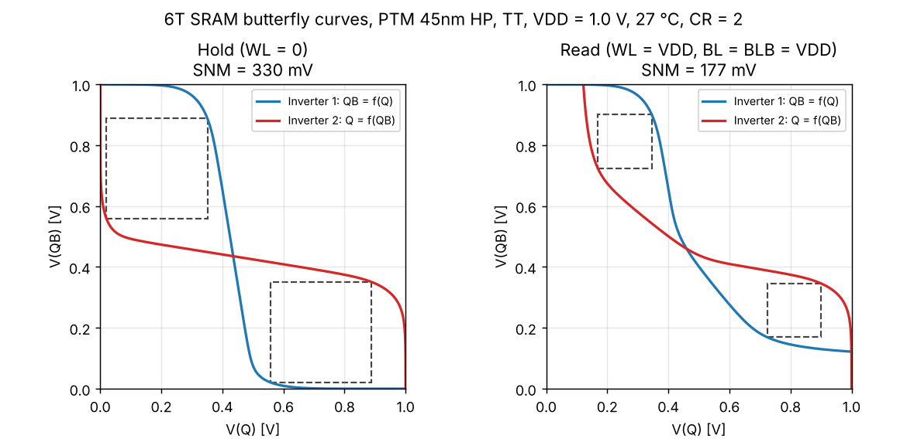
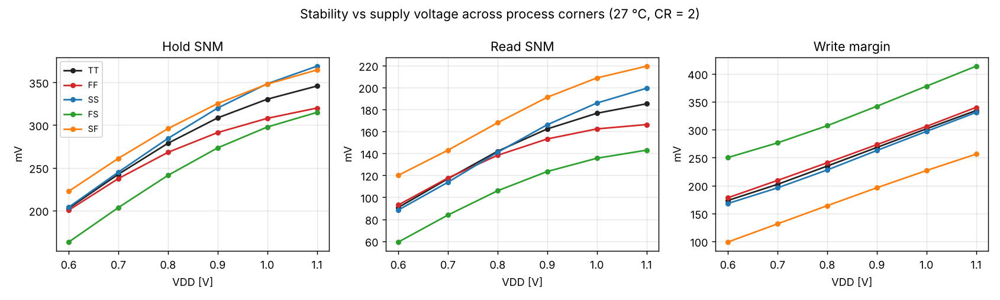
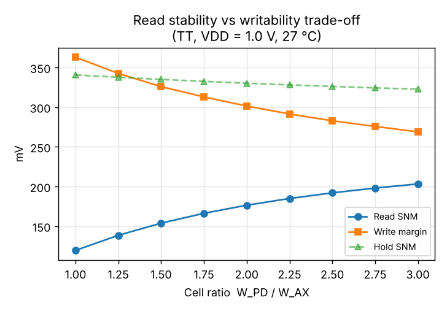
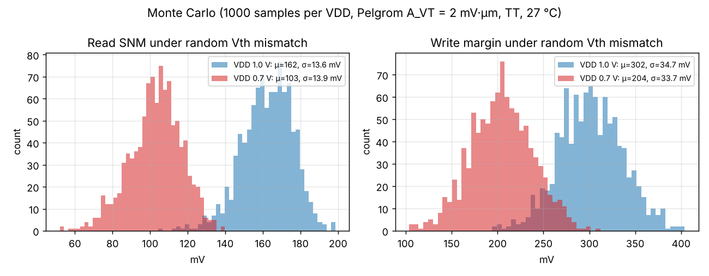

# 6T SRAM Stability Characterization (45nm, NGSPICE)

Read stability, hold stability and writability of a 6T SRAM bit cell, swept across supply voltage, process corners, temperature and cell sizing, plus a Monte Carlo mismatch study. Everything is simulated with **NGSPICE** on the **PTM 45nm high-performance BSIM4** model, and all metrics are extracted automatically in Python.



## Key results (TT, VDD = 1.0 V, 27 °C, cell ratio 2)

| Metric | Value |
|---|---|
| Hold SNM | **330 mV** |
| Read SNM | **177 mV** |
| Write margin | **302 mV** |
| Worst-corner read SNM (FS) | 136 mV |
| Worst-corner write margin (SF) | 227 mV |
| Read SNM at VDD = 0.6 V (TT / worst FS) | 91 mV / 59 mV |

**Monte Carlo, 1,000 samples per VDD (random Vth mismatch on all 6 transistors):**

| | VDD = 1.0 V | VDD = 0.7 V |
|---|---|---|
| Read SNM mean / σ | 162 mV / 13.6 mV | 103 mV / 13.9 mV |
| Read SNM μ/σ | **12.0** | **7.4** |
| Write margin mean / σ | 302 mV / 34.7 mV | 204 mV / 33.7 mV |
| Worst sample (read SNM) | 104 mV | 52 mV |
| Read / hold / write failures | 0 / 1000 | 0 / 1000 |

## What is measured

| Metric | Setup | Extraction |
|---|---|---|
| **Hold SNM** | WL = 0. Feedback loop broken, each half-cell VTC swept in DC | Largest square between the two butterfly curves (Seevinck method, 45° rotation) |
| **Read SNM** | WL = VDD, BL = BLB = VDD (worst case read, bit lines precharged) | Same; access transistor loads the storage node, so the "0" node rises (read disturb) |
| **Write margin** | WL = VDD, BLB = VDD, cell holds Q = 1; BL ramped VDD → 0 slowly | BL voltage at which Q and QB cross. Higher = easier to write |

The SNM is the side of the largest square that fits inside the smaller lobe of the butterfly plot. If one lobe disappears the cell is monostable and the SNM is reported as 0 (a read/hold failure).

## Sweeps

**1. Supply voltage × process corners** (0.6–1.1 V, TT/FF/SS/FS/SF)



* Read SNM is the tightest constraint at every corner and voltage. It drops from 177 mV at 1.0 V to 91 mV at 0.6 V (TT).
* **FS (fast nMOS, slow pMOS) is the worst read corner.** The weak pull-up flattens the inverter VTC, shrinking the lobes.
* **SF (slow nMOS, fast pMOS) is the worst write corner** (227 mV at 1.0 V, 99 mV at 0.6 V): a strong pull-up fights a weak access transistor.
* Hence read and write must be signed off at *opposite* skew corners.

**2. Temperature** (TT, 1.0 V)

| Temp | Hold SNM | Read SNM | Write margin |
|---|---|---|---|
| −40 °C | 353 mV | 211 mV | 235 mV |
| 27 °C | 330 mV | 177 mV | 302 mV |
| 125 °C | 306 mV | 142 mV | 339 mV |

Read stability degrades at high temperature, while writability degrades at low temperature.

**3. Cell ratio (W_PD / W_AX)**



Raising the cell ratio from 1 to 3 improves read SNM from 120 → 203 mV but lowers the write margin from 363 → 269 mV. This is the classic read-stability vs writability trade-off; CR ≈ 2 is used as the baseline.

**4. Monte Carlo mismatch**

Random threshold-voltage mismatch on all six transistors, Pelgrom's law σ(Vth) = A_VT / √(W·L) with A_VT = 2 mV·µm (σ = 22.2 mV for the pull-down, 31.4 mV for access and pull-up).



* Mismatch lowers the *mean* read SNM from 177 mV (nominal) to 162 mV at 1.0 V. SNM is set by the weaker lobe, so any asymmetry between the two halves of the cell costs margin.
* The spread (σ ≈ 14 mV) barely changes with VDD, but the mean does, so μ/σ drops from 12.0 at 1.0 V to 7.4 at 0.7 V. Lowering VDD eats the margin, not the variation.
* Write margin varies about 2.5× more than read SNM (σ ≈ 34 mV), driven by the small access and pull-up devices (σVth = 31 mV).
* No failures in 1,000 samples. 1,000 samples only resolve the distribution to about ±3σ, while Mb-scale arrays need ~6σ, so μ/σ is the useful yield indicator here and importance sampling is the natural next step.

## Cell and model

* 6T cell: pull-down 180 nm, access 90 nm, pull-up 90 nm, L = 45 nm (cell ratio 2, pull-up ratio 1).
* Model: [PTM](https://ptm.asu.edu/) 45nm HP metal-gate/high-k BSIM4 (level 54), nominal VDD 1.0 V. `models/ptm_45nm_hp.pm` comes from the PTM release (as redistributed in the open-source VTR project).
* Corners: PTM ships a single nominal deck, so corners are **emulated** with ±50 mV Vth shift (`delvto`) and ±10 % mobility (`mulu0`) per device type. These are not foundry corners; trends are meaningful, absolute corner values are approximate.

## Repository layout

```
models/ptm_45nm_hp.pm      PTM 45nm HP BSIM4 model card
netlists/                  Example half-cell VTC netlists (runnable directly in ngspice)
src/sram.py                Netlist generation, ngspice runner, SNM + write-margin extraction, mismatch model
src/run_all.py             All sweeps, CSVs, figures, summary.json
results/*.csv              Raw sweep data
results/summary.json       Headline numbers
results/figures/           Plots
```

## Run it

```bash
sudo apt install ngspice          # or: conda install -c conda-forge ngspice
pip install -r requirements.txt
python src/run_all.py --mc 1000 --jobs 4
```

To run one netlist by hand: `cd netlists && ngspice half_cell_read_vtc.cir`.

## Next steps

* Dynamic (transient) read/write stability and read current / access time
* Word-line and bit-line assist techniques (WL under-drive, negative BL) for low-VDD operation
* Importance sampling to estimate failure probability at the 5–6σ levels needed for large arrays
* An ML surrogate (e.g. gradient boosting on the Monte Carlo data) that predicts SNM from device Vth shifts, to speed up yield analysis

## References

* E. Seevinck, F. List, J. Lohstroh, "Static-noise margin analysis of MOS SRAM cells," IEEE JSSC, 1987.
* M. Pelgrom, A. Duinmaijer, A. Welbers, "Matching properties of MOS transistors," IEEE JSSC, 1989.
* Predictive Technology Model (PTM), Arizona State University.
